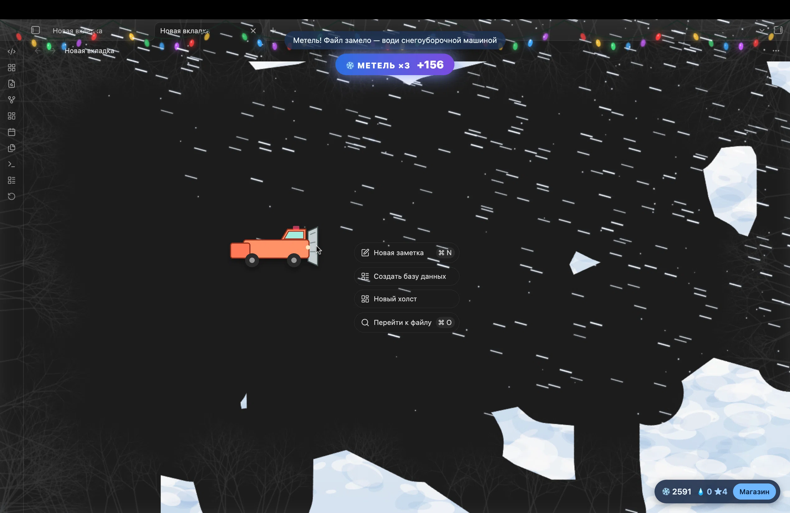

# snowdian for Obsidian

A plugin that turns writing into a small winter: snow falls across the screen, words get buried under drifts, and now and then a blizzard covers the whole file. Dig it out and earn.

```
Drift on a word  →  shovel (just move the cursor over the word)
Blizzard         →  snowplow
```



*Blizzard. The file is snowed in, the cursor turned into a snowplow, the counter at the top tracks earnings, the balance and the shop sit in the bottom corner.*

## Installation

**From the community directory:** open `Settings → Community plugins`, turn off Restricted mode, click **Browse**, search for `snowdian`, then **Install** and **Enable**.

**Manually:**

1. Download `main.js`, `manifest.json` and `styles.css` from the [latest release](https://github.com/avdeyaman/snowdian/releases/latest).
2. Put them into `<your vault>/.obsidian/plugins/snowdian/`.
3. Open `Settings → Community plugins` and enable **snowdian**.

Or clone the repository straight into the vault:

```bash
cd "<your vault>/.obsidian/plugins"
git clone https://github.com/avdeyaman/snowdian.git snowdian
```

The folder must be named `snowdian` — the same name is written in `manifest.json` as `id`. Restart Obsidian or enable the plugin in the settings afterwards.

The plugin is desktop-only (`isDesktopOnly`): it needs a cursor and a roomy screen.

## Usage

Open any note and keep writing — everything happens by itself.

- **Word drifts** — random words get snowed over. Move the cursor over a drift: it turns into a shovel. Sweep over the drift until the snow is gone and you earn ❄.
- **Blizzard** — every couple of minutes a storm buries all the visible text. The cursor becomes a snowplow, clearing pays noticeably more ❄, and clearing the whole file gives a bonus.
- **Sleet** — sometimes rain mixes in. Puddles stay under words, sweep them with a broom for 💧.
- **Ice** — rare ice crusts. Tougher than drifts, scraped with a scraper, and they pay more ❄.
- **Golden snowflake** — sometimes one falls. Click it in time and income doubles for 30 seconds.
- **Shop** — the button in the corner counter. Spend ❄ and 💧 on upgrades.

Snow pauses while you type, so it never gets in the way.

## What happens on screen

- **Snowfall** — light snow across the screen.
- **Frost** — a frozen vignette around the edges.
- **Garland** — twinkling lights along the top edge; mode, colors and speed are configurable.
- **Corner tree** — grows with your winter level and can be decorated with baubles and a star for 💧.

## Currencies

| Currency | Earned from | Spent on |
|---|---|---|
| ❄ snowflakes | drifts, ice, blizzards | shovel, plow, weather forecast, janitor |
| 💧 drops | puddles | broom, scraper, ornaments, rainbow |

Base payouts: a drift is 6 ❄, ice is 3 ❄, a puddle is 1 💧, a blizzard is about 120 ❄ plus a bonus for clearing it completely.

Earned ❄ also count towards winter level: each level adds +2% income. Multipliers stack with the “Chiming snow” upgrade (+15% per level).

## Shop and upgrades

The shop grows in price by 1.7× per level.

| Upgrade | Price | Effect |
|---|---|---|
| 🪏 Wide shovel | 40 ❄ | word drifts are cleared faster |
| 🚜 Wide plow | 60 ❄ | the snowplow clears a wider strip |
| 💰 Chiming snow | 80 ❄ | +15% ❄ for all snow |
| 🌨 Weather forecast | 70 ❄ | drifts and blizzards come more often |
| 🧑‍🔧 Janitor helper | 150 ❄ | clears drifts and puddles by itself, pays half |
| 🎨 Red plow | 250 ❄ | a fresh paint job for the snowplow |
| 🧹 Good broom | 4 💧 | puddles are cleared faster |
| 🪒 Ice scraper | 6 💧 | ice is cleared faster |
| 🎀 Tree ornaments | 8 💧 | baubles and a star on the tree |
| 🦆 Rubber duck | 10 💧 | a duck floats in every puddle |
| 🌈 Rainbow | 20 💧 | after sleet a rainbow appears: +8 ❄ per cleared puddle |

The janitor clears both snow and puddles. For a drift it pays half of what manual clearing gives (for a puddle — the same), so it is worth clearing yourself; the helper is more of a safety net for when you are busy.

## Commands

Available from the command palette (`Ctrl/Cmd+P`):

- `snowdian: blizzard now` — start a blizzard immediately
- `snowdian: bury a word` — drop a drift on a random word
- `snowdian: sleet` — start sleet
- `snowdian: shop` — open the shop
- `snowdian: clear everything` — remove snow, puddles, blizzard and buffs

## Settings

**What to show:** snowfall, frost, corner counter, garland, word drifts, sleet, blizzard, ice on words, corner tree, golden snowflake.

**Garland:** mode (twinkle, steady, alternating blink, running lights, wave, breathing, sparkles), colors (multicolor, rainbow, warm white, cool white, red & green, candy, aurora), speed.

**Snow:** density.

**Progress:** the “Reset progress” button. The first click asks for confirmation, the second one zeroes snowflakes, drops, winter level and all upgrades — appearance settings and language stay as they are.

## Languages

The plugin speaks Russian and English. The language is picked under “Interface language” in the settings:

| Value | Behavior |
|---|---|
| **Auto** (default) | follows the Obsidian language |
| **Русский** | always Russian |
| **English** | always English |

Everything you see is translated: command names in the palette, the shop and upgrade descriptions, settings labels, toasts, the blizzard hint and the cleanup summary. Switching applies immediately, without restarting Obsidian; command names in the palette refresh the next time it is opened.

## Requirements

- Obsidian 1.4.0 or newer
- Desktop (macOS, Windows, Linux)

## Files

| File | Purpose |
|---|---|
| `main.js` | all the logic: snowfall, drifts, blizzard, shop, garland, tree |
| `styles.css` | the look of the layers: drifts, puddles, ice, frost, garland, cursors, the helper |
| `manifest.json` | plugin metadata |
| `versions.json` | version compatibility with Obsidian versions |
| `assets/blizzard.png` | the blizzard screenshot used in this README |

Progress (snowflakes, drops, upgrades, level) is stored in `<vault>/.obsidian/plugins/snowdian/data.json` and never reaches the repository. The file is local: everyone has their own, so a fresh install always starts from zero and nobody inherits anyone else's save. You can reset your own progress with the button in the settings, or delete `data.json`.

## License

MIT

---

# snowdian для Obsidian

Плагин, который превращает работу в редакторе в маленькую зиму: идёт снег, слова заметает сугробами, а иногда налетает метель и заносит весь файл. Расчищай и зарабатывай.

```
Сугроб на слове  →  лопата (просто води курсором по слову)
Метель           →  снегоуборочная машина
```

## Установка

**Из каталога плагинов:** `Настройки → Сторонние плагины`, выключите ограниченный режим, нажмите **Обзор**, найдите `snowdian`, затем **Установить** и **Включить**.

**Вручную:**

1. Скачайте `main.js`, `manifest.json` и `styles.css` из [последнего релиза](https://github.com/avdeyaman/snowdian/releases/latest).
2. Положите их в `<ваше хранилище>/.obsidian/plugins/snowdian/`.
3. Откройте `Настройки → Сторонние плагины`, включите «snowdian».

Или клонируйте репозиторий прямо туда:

```bash
cd "<ваше хранилище>/.obsidian/plugins"
git clone https://github.com/avdeyaman/snowdian.git snowdian
```

Папка должна называться именно `snowdian` — это же имя записано в `manifest.json` как `id`. После клонирования перезапустите Obsidian или включите плагин в настройках.

Плагин работает только на десктопе (`isDesktopOnly`): ему нужен курсор и большая область экрана.

## Как пользоваться

Откройте любую заметку и пишите — всё происходит само.

- **Сугробы на словах** — случайные слова заносит снегом. Наведи курсор — он станет лопатой. Води по сугробу, пока он не растает: получаешь ❄.
- **Метель** — раз в пару минут налетает буря и заметает весь видимый текст. Курсор превращается в снегоуборочную машину, чистка даёт заметно больше ❄, а за полную уборку — бонус.
- **Снег с дождём** — иногда вместо снега идёт дождь со снегом. Под словами остаются лужи, их убирают метёлкой, и они платят капельками 💧.
- **Лёд на словах** — редкие ледяные корки. Крепче сугробов, счищаются скребком, но платят больше.
- **Золотая снежинка** — иногда падает золотая снежинка. Успей кликнуть: на 30 секунд доход удваивается.
- **Магазин** — кнопка в счётчике в углу. Трать ❄ и 💧 на апгрейды.

Снег и лёд не появляются, пока вы печатаете, — чтобы не отвлекать.

## Что происходит на экране

- **Снегопад** — лёгкий снег по всему экрану.
- **Иней** — замёрзшая виньетка по краям окна.
- **Гирлянда** — мигающие лампочки вдоль верхнего края. Режим, цвета и скорость настраиваются.
- **Ёлка в углу** — растёт вместе с зимним уровнем, а за 💧 её можно нарядить шарами и звездой.

## Экономика

| Валюта | За что | Куда тратить |
|---|---|---|
| ❄ снежинки | сугробы, лёд, метель | лопата, отвал, метеосводка, дворник |
| 💧 капельки | лужи | метёлка, скребок, украшения, радуга |

Базовые выплаты: сугроб — 6 ❄, лёд — 3 ❄, лужа — 1 💧, метель — около 120 ❄ плюс бонус за полную уборку.

Заработанные ❄ идут ещё и в зимний стаж: каждый уровень даёт +2% к доходу. Множители складываются с апгрейдом «Звонкий снег» (+15% за уровень).

## Магазин и апгрейды

Цена растёт в 1.7 раза за уровень.

| Апгрейд | Цена | Что даёт |
|---|---|---|
| 🪏 Широкая лопата | 40 ❄ | сугробы счищаются быстрее |
| 🚜 Широкий отвал | 60 ❄ | машина чистит более широкую полосу |
| 💰 Звонкий снег | 80 ❄ | +15% к ❄ за весь снег |
| 🌨 Метеосводка | 70 ❄ | сугробы и метели приходят чаще |
| 🧑‍🔧 Дворник-помощник | 150 ❄ | сам убирает сугробы и лужи, платит половину |
| 🎨 Красная машина | 250 ❄ | новая покраска снегоуборщика |
| 🧹 Хорошая метёлка | 4 💧 | лужи убираются быстрее |
| 🪒 Скребок | 6 💧 | лёд счищается быстрее |
| 🎀 Украшения на ёлке | 8 💧 | шары и звезда на ёлке |
| 🦆 Резиновая уточка | 10 💧 | в каждой луже плавает уточка |
| 🌈 Радуга | 20 💧 | после снега с дождём встаёт радуга: +8 ❄ за каждую лужу |

Дворник сгребает и снег, и лужи. За сугроб он получает вдвое меньше, чем при ручной уборке (за лужу — столько же), так что выгоднее чистить самому, а помощник скорее страховка на время, когда не до мышки.

## Команды

Доступны через палитру команд (`Ctrl/Cmd+P`):

- `snowdian: метель сейчас` — вызвать метель немедленно
- `snowdian: замести слово` — насыпать сугроб
- `snowdian: снег с дождём` — вызвать дождь со снегом
- `snowdian: магазин` — открыть магазин
- `snowdian: растопить всё` — убрать снег, лужи, метель и бонусы

## Настройки

**Внешний вид:** снегопад, иней, счёт в углу, гирлянда, сугробы на словах, снег с дождём, метель, лёд на словах, ёлка в углу, золотая снежинка.

**Гирлянда:** режим (мерцание, ровный свет, попеременное мигание, бегущие огни, волна, дыхание, искры), цвета (разноцветная, радужная, тёплая белая, холодная белая, красно-зелёная, розово-белая, северное сияние), скорость.

**Снег:** густота.

**Прогресс:** кнопка «Сбросить прогресс». Первый клик просит подтверждение, второй обнуляет снежинки, капельки, зимний уровень и все апгрейды — настройки внешнего вида и язык остаются как были.

## Языки

Плагин говорит по-русски и по-английски. Язык интерфейса выбирается в настройках:

| Значение | Поведение |
|---|---|
| **Авто** (по умолчанию) | берётся язык Obsidian |
| **Русский** | всегда русский |
| **English** | всегда английский |

Переключение применяется сразу, без перезапуска Obsidian; названия команд в палитре обновятся при следующем её открытии.

## Языки для разработки

Строки лежат в объекте `I18N` в начале `main.js` — два набора ключей, `ru` и `en`, по 91 строке каждый. Чтобы добавить язык, скопируйте набор `en`, переведите значения и добавьте код языка в `detectLang()` и в выпадающий список настроек. Обращаться к строкам из кода нужно через `this.t("ключ")`, подстановки — через `this.t("ключ", { n: 5 })`.

## Требования

- Obsidian 1.4.0 или новее
- Десктоп (macOS, Windows, Linux)

## Лицензия

MIT
